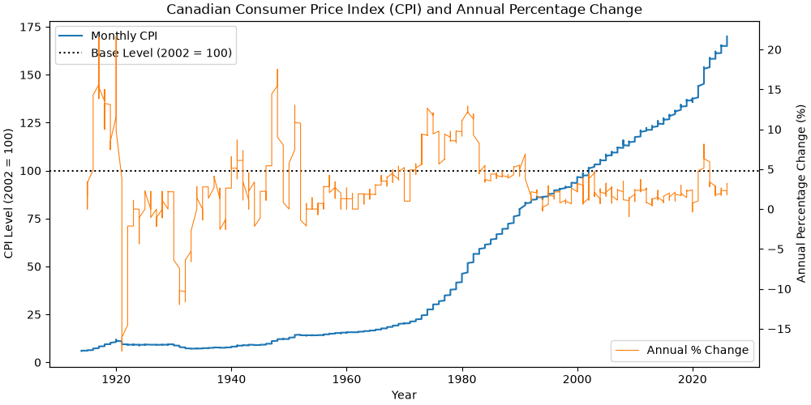

# FINE3300 Assignment 2: Inflation Calculator
## 1. Project Description
This project replicates and enhances the Bank of Canada's Inflation Calculator (https://www.bankofcanada.ca/rates/related/inflation-calculator/) using Python.
While the Bank of Canada's calculator only takes in years as inputs, the Statistics Canada dataset (`STATIC_INFLATIONCALC.csv`) records the Consumer Price Index (CPI) on a monthly basis starting in January 1914. This project loads and cleans the monthly CPI dataset, plots the historical CPI series alongside its 12-month percentage change, and provides an interactive monthly calculator that computes inflation-adjusted prices between any two periods in the dataset.
## 2. Project Files
- **`InflationCalculator.py`**: The main Python script that reads and cleans the CPI data using Pandas, plots the dual-axis time-series graph using Matplotlib, validates user inputs, and calculates monthly inflation metrics using NumPy.
- **`STATIC_INFLATIONCALC.csv`**: The source dataset from the Bank of Canada / Statistics Canada containing monthly CPI observations from January 1914 to the present.
- **`cpi_graph.png`**: The dual-axis time-series graph generated by `InflationCalculator.py`, showing the monthly CPI level (left axis), the `2002 = 100` base level (dotted line), and the annual percentage change (right axis).
- **`README.md`**: Project documentation, setup instructions, CPI graph commentary, and sample calculator output.

## 3. How to Replicate the Project & Interact with the Application
Follow the steps below to clone this repository to your computer, install the required Python libraries (`pandas`, `numpy`, and `matplotlib`), and run the application:
1. **Open your terminal and clone this repository:**
   ```bash
   git clone <https://github.com/Angus-Wan-59/FINE3300-2026-A2.git>
   ```
2. **Navigate into the project folder:**
   ```bash
   cd FINE3300-2026-A2
   ```
3. **Install the required Python libraries (Pandas, NumPy, and Matplotlib):**
   ```bash
   pip install pandas numpy matplotlib
   ```
4. **Run the Python application:**
   ```bash
   python InflationCalculator.py
   ```
5. **Interact with the Inflation Calculator in the terminal:**
   - When prompted, enter a positive dollar amount for the basket of goods/services (e.g., `100.00`).
   - Enter the first period in `YYYY-MM` format (e.g., `2005-05`).
   - Enter the second period in `YYYY-MM` format (e.g., `2026-05`).
   - The program will validate your inputs, print the formatted inflation comparison table in the terminal, save `cpi_graph.png` to the project folder, and display the graph window.
## 4. Graph of the Consumer Price Index (CPI) & Commentary

### Short Commentary on the CPI
- **Long-Term Upward Trend:** The blue CPI line shows that consumer prices in Canada remained relatively stable from 1914 through the mid-1940s, before rising steadily over the post-World War II decades and crossing the base index level of 100 in 2002.
- **Early Volatility & Deflation:** The orange annual percentage change line (right axis) highlights sharp spikes in inflation following World War I (exceeding 18%), followed immediately by sharp deflation (negative annual CPI change) in 1921 and again during the Great Depression (1930–1933).
- **1970s Inflation vs. Post-1991 Stability:** Annual inflation persistently exceeded 10% during the 1970s and early 1980s energy crises. After the Bank of Canada introduced its inflation-targeting framework in 1991, annual CPI growth remained tightly anchored near 2% until the post-2020 pandemic supply shocks.

### Sources
- Bank of Canada, Inflation Targeting in Canada: Experience and Lessons: https://www.bankofcanada.ca/wp-content/uploads/2010/01/sp02-1.pdf
## 5. Sample Output from the Inflation Calculator
```text
------------------------------------------------------------
BANK OF CANADA MONTHLY INFLATION CALCULATOR
------------------------------------------------------------
Enter the price of goods/services ($): 100.00
Enter the first period (YYYY-MM): 2005-05
Enter the second period (YYYY-MM): 2026-05
------------------------------------------------------------
A basket of goods and services that cost $100.00 CAD in 2005-05
would cost $158.95 CAD in 2026-05.
------------------------------------------------------------
Percent change:                    58.95%
Difference in number of years:     21.00 years (252 months)
Average annual rate of inflation:  2.23%
CPI for first period (2005-05):    106.7
CPI for second period (2026-05):   169.6
Base Level:                        2002 CPI = 100.0
------------------------------------------------------------
```
